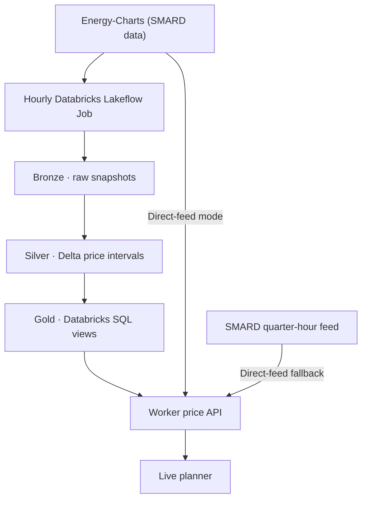

# Power Window

[**Try the interactive demo**](https://bakk0u.github.io/Power-window/)

Power Window finds the cheapest uninterrupted time to run an appliance or charge an EV. Set the run time, average power and finish time, then select a bar to compare that start with the recommended window.

The public demo replays quarter-hour wholesale prices for Germany and Luxembourg from 23 November 2026. The deployed Databricks job checks for new or corrected prices every hour. Times are shown in Berlin time, and estimates cover wholesale energy only.

## How it works

The Worker serves the live planner and `/api/prices`. It can query Databricks SQL or run in direct-feed mode. The planner skips gaps in the price series and compares only consecutive quarter-hours.

## Inside the lakehouse

- [**Job configuration**](lakehouse/databricks.yml) defines the hourly Lakeflow Job, schedule, and retries.
- [**Ingestion**](lakehouse/src/refresh.py) archives raw responses in bronze, merges price corrections into silver by UTC delivery interval, and creates the gold views for priced intervals and complete one-hour windows.
- [**Data quality**](lakehouse/src/market.py) checks units, price values, timestamp alignment and duplicates. The [tests](lakehouse/tests/) cover unpublished prices, Berlin clock changes, and Delta merges.

## Run locally

With Node.js 22 or later, run `npm test` and `npm run dev`, then open [localhost:5173](http://localhost:5173). Direct-feed mode needs no API key. To deploy the job and connect the Worker to the warehouse, see the [Databricks setup guide](lakehouse/README.md).

Market data from [Bundesnetzagentur | SMARD.de](https://www.smard.de/) via [Fraunhofer ISE Energy-Charts](https://energy-charts.info/) under [CC BY 4.0](https://creativecommons.org/licenses/by/4.0/).
